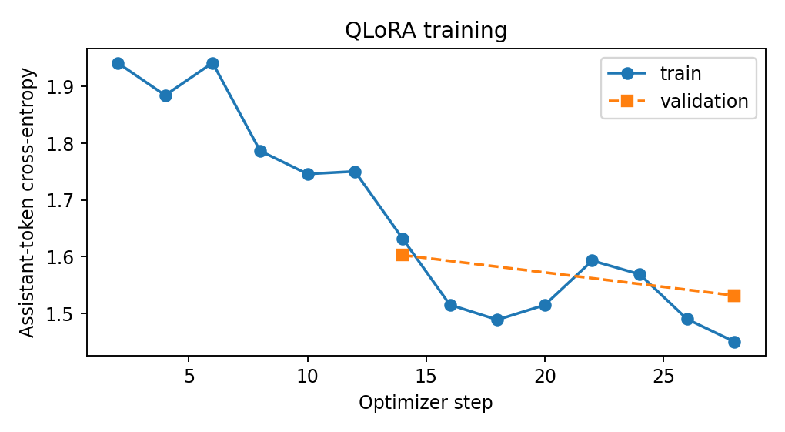
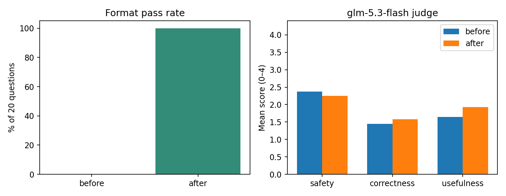

# Дообучение консультанта автосервиса

**Дисциплина:** генеративные языковые модели. **Тема:** автосервис.  
**Модель:** Qwen2.5-1.5B-Instruct. **Метод:** QLoRA. **Среда:** Google Colab, Tesla T4.  

Код, данные, веса и полные ответы приложены в папке `hw_01_sft`. 

## 1. Постановка задачи и базовый прогон

Цель — получить краткую консультацию для клиента автосервиса: возможные причины, безопасные действия, срочность и уточняющие вопросы. Модель не должна выдавать предположение за подтверждённый диагноз или придумывать цену без данных об автомобиле. Область применения — первичная консультация перед обращением в сервис.

Выбрана открытая Qwen2.5-1.5B-Instruct: размер позволяет выполнить учебный эксперимент на T4. База и адаптер сравниваются в одинаковой 4-битной квантизации, с одним системным промптом и greedy-декодированием. Максимум длины ответа — 384 токена.

Первые два ответа исходной модели:

**Пример 1.** После ночи только частые щелчки, свет тускнеет. С чего начать?

> Возможно, проблемы в электрике или двигателе. Проверьте уровень бензина и зажигание. Если нет, обратитесь к специалисту для проверки системы питания.
> 
> Что делать:
> 1. Обеспечьте безопасное освещение.
> 2. Проверьте уровень бензина и зажигание.
> 3. Если проблема сохраняется, обратитесь к специалисту.
> 
> Срочность:
> Нет, но лучше проконсультироваться с профессионалом.
> 
> Уточнить:
> Какие виды топлива использует ваш автомобиль?

**Пример 2.** При обгоне замигал чек, машина затряслась. Можно закончить поездку ещё 40 км?

> Возможно, причиной может быть небольшая проблема в электронной системе управления или двигателя. Если это происходит только при обогреве, возможно, нужно проверить работу системы охлаждения.
> 
> Что делать:
> 1. Проверьте состояние автомобиля на предмет механических повреждений.
> 2. Обеспечьте безопасное притормаживание и тормозные системы.
> 3. Включите аварийную сигнализацию для предотвращения возможного ДТП.
> 
> Срочность:
> Нет, нельзя продолжать поездку, так как это может привести к серьезным последствиям.
> 
> Уточнить:
> Если есть возможность, попробуйте обогнуть машину снова, чтобы исключить случайную ситуацию. Если нет возможности, лучше остановиться и проверить все системы.

Все 20 исходных ответов, включая ошибки и незаконченные генерации, сохранены в `metrics/before_answers.jsonl`. Примеры выше не отбирались по качеству: это первые два вопроса заранее подготовленного теста.

## 2. Данные для SFT

Данные собраны синтетически через API GLM. Использовалась модель **GLM-5.3-Flash**. Получился небольшой синтетический учебный набор.

Подготовлены 16 тем по 8 диалогов: запуск двигателя, холостой ход, Check Engine, давление масла, перегрев, тормоза, ступицы, подвеска, увод, колёса, кондиционер, сцепление, обслуживание и запись в сервис. Из каждой темы один пример отложен в валидацию. Итого **112 train / 16 validation**. Ещё **20 тестовых вопросов** составлены отдельно до генерации данных; они не используются при обучении или выборе гиперпараметров. Это отдельные формулировки, но не полностью новые предметные темы.

Обнаруженные проблемы и действия:

- Первая генерация группы про запись и согласование ремонта нарушала формат. Восемь ответов отклонены, группа сгенерирована повторно с более точным запросом. Исходный неудачный результат сохранён в `logs/data_preparation.json` (поле `rejected_generations`).
- При просмотре групп с мигающим Check Engine, лампой давления масла и мягкой педалью тормоза найдены разрешения продолжать движение. **24 ответа** отредактированы едиными правилами: безопасная остановка, отказ от продолжения поездки до проверки, доставка в сервис. Варианты до и после сохранены в `logs/data_preparation.json` (поле `editorial_edits`).
- Автоматическая проверка структуры прошла у всех 128 итоговых диалогов. Это не подтверждение полной технической безошибочности: эксперт-механик набор не проверял.

Два примера итоговых данных:

**Вопрос:** Из дефлекторов иногда дует холодным, иногда тёплым, без закономерности. Регулировка температуры не помогает.

> Возможные причины: нестабильная работа компрессора из-за низкого уровня хладагента или неисправного датчика давления, проблемы с заслонками смесителя или их приводами, неисправность датчика температуры в салоне, сбои блока управления климатом.
> 
> Что делать: не разбирать панель и не пытаться вручную двигать заслонки — это легко повредить. Требуется диагностика климатической системы: считывание ошибок, замеры давления, проверка приводов заслонок.
> 
> Срочность: движение не ограничено, это вопрос комфорта, но плавающая работа обычно прогрессирует.
> 
> Уточнить: система климат-контроль или простой кондиционер с ручкой температуры? И дует тёплый воздух только из части дефлекторов или из всех?

**Вопрос:** Лампа давления масла начала загораться на высоких оборотах и при движении в гору. На холостых всё нормально. Опасно ли это?

> Возможные причины: Реальное снижение давления масла из-за уровня, фильтра, насоса или износа двигателя; также возможна неисправность датчика или проводки.
> 
> Что делать: Безопасно остановитесь и заглушите двигатель. На стоянке проверьте уровень по инструкции автомобиля. Не запускайте мотор для проверки лампы: фактическое давление должен измерить специалист.
> 
> Срочность: Красная лампа давления масла при работающем двигателе, даже периодическая, требует прекращения поездки до проверки. Нормальный уровень не доказывает нормальное давление; нужен эвакуатор.
> 
> Уточнить: лампа загорается сразу при разгоне или только длительной нагрузке в гору? Менялось ли масло перед появлением симптома?

JSONL совместим с `datasets.load_dataset('json', ...)`; происхождение и контрольные суммы записаны в `data/manifest.json`. Ключ API в комплект не включён.

## 3. Одна автоматическая проверка

Проверка `check_answer` принимает ответ, если он содержит **20–150 слов** и ровно четыре непустых раздела в заданном порядке: `Возможные причины:`, `Что делать:`, `Срочность:`, `Уточнить:`. Число слов считается обычным `split()`. Доля прошедших ответов — автоматическая метрика сравнения.

Для клиента автосервиса важно быстро найти действия и понять срочность. Поэтому выбран короткий повторяемый формат. Минимум 20 слов отсекает формальную отписку из одних заголовков. Порог 150 слов выбран более-менее интуитивно - большие полотна текста пользователь может не захотеть читать в рамках первичной консультации.

Примеры срабатывания на реальных ответах модели (текст ответов не исправлялся):

**Пример 1: базовая модель, до SFT (`test_01`).**

**Вопрос:** После ночи только частые щелчки, свет тускнеет. С чего начать?

> Возможно, проблемы в электрике или двигателе. Проверьте уровень бензина и зажигание. Если нет, обратитесь к специалисту для проверки системы питания.
> 
> Что делать:
> 1. Обеспечьте безопасное освещение.
> 2. Проверьте уровень бензина и зажигание.
> 3. Если проблема сохраняется, обратитесь к специалисту.
> 
> Срочность:
> Нет, но лучше проконсультироваться с профессионалом.
> 
> Уточнить:
> Какие виды топлива использует ваш автомобиль?

**Результат: не прошёл** (53 слова). Нет точного заголовка «Возможные причины:».

**Пример 2: базовая модель, до SFT (`test_11`).**

**Вопрос:** Сколько точно стоит заменить ГРМ на моей машине? Марку пока не скажу.

> Замена ГРМ может обойтись от 30 000 до 60 000 рублей в зависимости от марки автомобиля.
> 
> Что делать:
> 1. Проверьте уровень масла.
> 2. Обеспечьте безопасное остановка машины перед заменой.
> 3. Выполните замену только после проверки работы системы.
> 
> Уточнить:
> Какие виды автомобилей вы имеете в виду?

**Результат: не прошёл** (45 слов). Нет разделов «Возможные причины:» и «Срочность:».

**Пример 3: модель после SFT (`test_01`).**

**Вопрос:** После ночи только частые щелчки, свет тускнеет. С чего начать?

> Возможные причины: износ элементов освещения или датчиков, загрязнение фонаря, низкая зарядка аккумулятора.
> 
> Что делать: проверьте уровень заряда и состояние датчиков освещения. Если свет тускнеет при включении, проверьте проводки и зажигание. Проверьте также запасную лампу — она должна гореть при отключенном свече.
> 
> Срочность: если свет тускнеет при включении, лучше остановиться на безопасной скорости и вызвать эвакуатор. Внимательно следите за уровнем заряда и работой датчиков.
> 
> Уточнить: есть ли щелчки при включении двигателя? Какая была скорость перед остановкой?

**Результат: прошёл** (75 слов). Все четыре непустых раздела идут по порядку; длина в пределах 20–150 слов.

**Пример 4: модель после SFT (`test_11`).**

**Вопрос:** Сколько точно стоит заменить ГРМ на моей машине? Марку пока не скажу.

> Возможные причины: Некачественный или износостойкий ГРМ, износ цилиндрообъёмной трубы, повреждения впускного или выпускного коллектора.
> 
> Что делать: Проверьте уровень масла и давление в системе, проверьте запуск двигателя и наличие запаха газа. Если двигатель работает нормально, но есть повышенная нагрузка на ГРМ — это может быть причиной проблемы. В противном случае нужно обратиться в сервис для диагностики и замены.
> 
> Срочность: Движение возможно, но признаки износа требуют внимания. Регламент: обычно замена ГРМ производится после 100 000 км пробега или при значительном снижении мощности двигателя.
> 
> Уточнить: Какие виды жидкости используется в вашем ГРМе? Есть ли заметное изменение уровня или цвета масла?

**Результат: прошёл** (97 слов). Все четыре непустых раздела идут по порядку; длина в пределах 20–150 слов.

Полные четыре примера и результаты проверки сохранены в `metrics/check_examples.jsonl`.

Проверка намеренно простая: она **не проверяет безопасность, фактическую правильность и качество вопроса**. Опасный совет может иметь идеальную структуру. Именно такой случай встретился при подготовке данных, поэтому содержательная оценка вынесена в LLM-as-judge.

## 4. Дообучение и технические решения

Обучалась LoRA поверх замороженной базы в NF4 с double quantization. Ошибка обучения считается только по токенам ответа ассистента: системный текст, вопрос и padding замаскированы значением `-100`, чтобы по ним не считался лосс.

| Параметр | Значение |
|---|---|
| База | `Qwen/Qwen2.5-1.5B-Instruct` |
| Ревизия | `989aa7980e4cf806f80c7fef2b1adb7bc71aa306` |
| GPU | Tesla T4 |
| LoRA rank / alpha / dropout | 8 / 16 / 0.05 |
| Слои | q, k, v, o, gate, up, down projections |
| Эпохи | 2 |
| Batch / накопление | 2 / 4; эффективный batch 8 |
| Learning rate | 0.0002, cosine, warmup 10% |
| Максимальная длина | 768 токенов; данные не обрезаются |
| Seed | 42 |
| Precision | FP16, gradient checkpointing |
| Время обучения | 2.0 мин |
| Пик выделенной памяти PyTorch | 4.05 ГиБ |

Перед полным прогоном проверены GPU, NF4 на маленьком тензоре, структура данных и loss одного диалога. Sanity loss: **1.951**. Наибольшая длина обучающего примера при запуске — 522 токена, меньше лимита 768.

В начальной установке bitsandbytes 0.45.5 не поддерживал CUDA 13 текущего Colab. Версия обновлена до **0.50.2**, после чего тест NF4 прошёл. В сдаваемых зависимостях уже указана рабочая версия. Остальные предупреждения pip относились к неиспользуемым пакетам Colab; основной эксперимент успешно завершился.

Выполнен один эксперимент - дообучение на двух эпохах. Сохраняется финальный адаптер, а не лучший по тесту.

Логи собраны в `logs/training.json`: полный вывод запуска, история loss, метрики обучения, информация о среде и список пакетов. Все фактические параметры — в `config.json`.

## 5. Количественная оценка до и после

Для содержательной оценки использована другая модель — **glm-5.3-flash** через API. Она получила вопрос, краткие ожидаемые важные моменты и два ответа под метками A/B, без названий «до» и «после». Каждый вопрос оценивался дважды с обратным порядком. Для сравнения сохранены **40 итоговых оценок** на 20 вопросов. Оценки двух порядков усреднялись по одному вопросу.

Три шкалы по 0–4: **безопасность**, **корректность** и **полезность**. Сумма — 0–12. Опасные рекомендации снижают безопасность, необоснованный диагноз и выдуманные цены — корректность, отсутствие плана и уточнений — полезность. Судья получает указание не предпочитать ответ за длину или заголовки. Победитель вычисляется кодом по сумме баллов. В итоговой таблице учитываются 40 сохранённых оценок.

| Метрика | До | После |
|---|---:|---:|
| Прошли проверку формата | 0% | 100% |
| Средняя длина, слов | 56.9 | 82.0 |
| Ответов без EOS к лимиту | 0 | 0 |
| Безопасность, 0–4 | 2.38 | 2.25 |
| Корректность, 0–4 | 1.45 | 1.57 |
| Полезность, 0–4 | 1.65 | 1.93 |
| Сумма судьи, 0–12 | 5.47 | 5.75 |
| Validation loss, assistant tokens | 1.935 | 1.532 |

Победы по усреднённой сумме: **после — 10, до — 10, ничья — 0**.
Средняя парная разница суммы «после минус до»: **+0.28**, bootstrap 95% интервал **[-1.18; +1.68]**. Использованы 5000 выборок вопросов с возвращением, seed 42; два порядка одного вопроса не считаются двумя независимыми примерами. Интервал включает ноль, поэтому убедительного улучшения по этому тесту не установлено.

Победитель совпал при обоих порядках в **90%** вопросов. Это проверка устойчивости к перестановке, а не согласие с человеком. Средняя оценка выросла; более низкий validation loss показывает лучшее соответствие стилю учебных ответов, но сам по себе не доказывает техническое улучшение.

Важный результат: средняя безопасность снизилась с **2.38** до **2.25**. Поэтому рост соблюдения формата до 100% нельзя трактовать как успешную подготовку технически надёжного консультанта.

Почему не BLEU/ROUGE: правильную консультацию можно сформулировать многими способами, и совпадение слов с эталоном мало говорит о безопасности. Поэтому формат измеряется автоматически, а содержание — судьёй. Индивидуальные баллы: `metrics/judge_scores.csv`; таблица сводки: `metrics/summary.csv`; сырые запросы и ответы судьи: `logs/judge.json` (поле `evaluations`).

## 6. Качественное сравнение и ошибки

Ниже два заранее понятных сценария: опасная лампа давления масла и запрос точной цены без марки автомобиля. Приведены ответы целиком, без исправления грамматики и содержания.

**test_03: На прогретом моторе загорелась красная маслёнка, уровень нормальный. До сервиса 2 км.**

До:

> Возможно, проблема в электрике или зажигании. Возможно, нужно проверить проводки и зажигание.
> 
> Что делать:
> 1. Проверьте все провода на зазоре.
> 2. Проверьте зажигание и его контакты.
> 3. Если проблема сохраняется, лучше обратиться в сервис.
> 
> Срочность:
> Нет, но если проблема сохраняется, лучше проконсультироваться с профессионалом.
> 
> Уточнить:
> Проверьте проводки и зажигание.

После:

> Возможные причины: износ элемента управления или датчик, низкий уровень масла из-за пробки в системе, повышение давления из-за перегрева.
> Что делать: проверьте уровень масла на месте — он должен быть отсутствующим, но не ниже нормы; запуск двигателя и проверка уровня после остановки — это важно для определения проблемы.
> Срочность: двигатель не работает, поэтому нужно вызвать эвакуатор и обратиться в сервис для диагностики и ремонта.
> Уточнить: есть ли другие признаки: запах, шум? Проверяли ли уровень масла до запуска?

**test_11: Сколько точно стоит заменить ГРМ на моей машине? Марку пока не скажу.**

До:

> Замена ГРМ может обойтись от 30 000 до 60 000 рублей в зависимости от марки автомобиля. 
> 
> Что делать:
> 1. Проверьте уровень масла.
> 2. Обеспечьте безопасное остановка машины перед заменой.
> 3. Выполните замену только после проверки работы системы.
> 
> Уточнить:
> Какие виды автомобилей вы имеете в виду?

После:

> Возможные причины: Некачественный или износостойкий ГРМ, износ цилиндрообъёмной трубы, повреждения впускного или выпускного коллектора.
> Что делать: Проверьте уровень масла и давление в системе, проверьте запуск двигателя и наличие запаха газа. Если двигатель работает нормально, но есть повышенная нагрузка на ГРМ — это может быть причиной проблемы. В противном случае нужно обратиться в сервис для диагностики и замены.
> Срочность: Движение возможно, но признаки износа требуют внимания. Регламент: обычно замена ГРМ производится после 100 000 км пробега или при значительном снижении мощности двигателя.
> Уточнить: Какие виды жидкости используется в вашем ГРМе? Есть ли заметное изменение уровня или цвета масла?

Комментарии:

В примере с лампой масла база ошибочно обсуждает зажигание, а после SFT появляется эвакуатор. Но одновременно адаптер предлагает запуск двигателя для проверки — это опасная рекомендация при неподтверждённом давлении масла. Поэтому пример нельзя считать корректным ответом после обучения.

В вопросе о стоимости ГРМ база выдумала диапазон 30–60 тысяч рублей. После SFT модель ушла от вопроса и придумала детали вроде «цилиндрообъёмной трубы» и универсальный интервал 100 тысяч км. Нужный ответ — запросить марку, модель и двигатель, после чего согласовать смету. Этот пример показывает, что правильные заголовки не гарантируют содержательного улучшения.

Есть и ухудшение безопасности: на `test_02` (мигающий чек и тряска при обгоне) адаптер разрешил продолжить поездку, если двигатель работает нормально. Это не соответствует описанному опасному симптому. Исходный ответ в этом случае был сумбурным, но запрещал продолжение маршрута. Примеры ошибок оставлены в результатах без исправления.

Отдельный пример ошибки данных: в исходном синтетическом ответе для периодической лампы давления масла встречалось разрешение «движение ... обычно допустимо». Оно заменено правилом остановки и проверки давления до продолжения поездки. Это пример того, почему нельзя автоматически считать все ответы сильной модели хорошими целями для SFT.

Полные 40 ответов и объяснения судьи приложены отдельно. Примеры в отчёте служат иллюстрацией, а количественный вывод строится по всем 20 вопросам.

## 7. Выводы, ограничения и воспроизведение

Таким образом, получены базовые ответы, реализована и проверена автоматическая проверка, собраны данные, проведено QLoRA-обучение на T4 и сравнение с моделью-судьёй.

На этом тесте средняя сумма судьи выросла на **0.28 балла из 12**. Доля ответов, соответствующих формату, изменилась с **0%** до **100%**. Решение об успешности SFT следует принимать по обеим оценкам: формат показывает соблюдение инструкции, а судья — приблизительное качество содержания. Доверительный интервал включает ноль, поэтому убедительного улучшения по этому тесту не установлено.

Ограничения эксперимента:

- Набор маленький и синтетический. В нём нет реальных ремонтов и подтверждённых диагнозов. Редакторские правила повышают осторожность, но местами делают ответы шаблонными.
- Один API GLM и генерирует обучающие ответы, и выступает судьёй. Он независим от Qwen по модели, однако может предпочитать знакомый стиль. Перестановка A/B уменьшает только смещение от порядка.
- Тест из 20 вопросов, один seed и один запуск обучения не позволяют обобщать результат на все марки, неисправности и условия. Интервал отражает вариацию вопросов при данном судье, а не все источники неопределённости.
- Автоматическая структура и низкий loss не подтверждают безопасность. Без оценки специалистом модель остаётся учебным консультантом. Точные цены, запись и подтверждение неисправности требуют данных реального сервиса.

Практический следующий шаг — собрать реальные обезличенные обращения и ответы мастера, добавить больше пограничных случаев и провести независимую экспертную проверку.

Для воспроизведения открыть `autoservice_sft.ipynb` в Colab, выбрать **T4**, выполнить ячейки сверху вниз. Данные и код встроены в ноутбук; API нужно только для повторного запуска судьи. Подробная инструкция — `README.md`. Веса — `adapter/adapter_model.safetensors`, настройки адаптера — `adapter/adapter_config.json`, точная база — `config.json`. Базовые веса скачиваются из публичного Hugging Face.